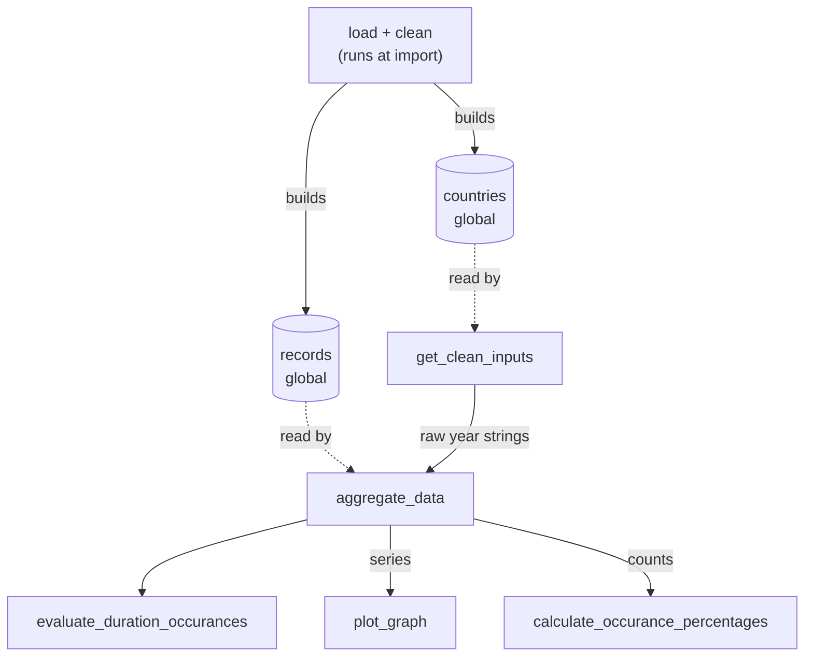

# Assessment of the inherited code

Written before any restructuring, against commit `d3f969b`.

## What it does

`evacodev2.py` is one 122-line script. It reads `eva-data.json` (375 EVAs: 236 USA, 139 Russia), then:

1. Drops entries missing a date, duration or country, converts `H:MM` durations to decimal hours, and sorts by date (330 entries survive).
2. Asks for a country, start year and end year. Blank or unknown means "all countries" or "no limit".
3. Filters by country and years (inclusive) and builds a running total of hours.
Counts EVAs as short (under 4 h), standard (4 to under 7 h) or long (7 h+).
4. Saves and shows a plot of the running total.
5. Prints the category counts and percentages.

The git history shows five rounds of work (plot, country filter, year filter, docstrings, categories). Each one added code to the same file.

## What happens when you run it

| Input (country, from, to) | Result |
| --- | --- |
| USA, 1965, 1975 | Works: `{'short': 29, 'standard': 9, 'long': 7}` |
| blank, blank, blank | Works: `{'short': 71, 'standard': 187, 'long': 72}` |
| Narnia, blank, blank | Quietly treated as all countries |
| USA, 2200, 2300 (no matches) | Crashes: `ZeroDivisionError` |
| USA, 1975, 1965 (reversed) | Crashes: `ZeroDivisionError` |
| USA, abc, blank | Crashes: `ValueError` |

The working rows are the behaviour to keep. The crashes are bugs.

## Responsibilities and where they live

Everything lives in one module.

| Responsibility | Where |
| --- | --- |
| Reading data | module level, lines 5-6 |
| Validating and preparing data | module level, lines 8-27 |
| Calculating | `aggregate_data`, `evaluate_duration_occurances`, `calculate_occurance_percentages` |
| Presenting | `plot_graph`, plus the `print` calls at the end |
| Coordinating and user input | `get_clean_inputs`, plus module-level lines 118-122 |

## Where responsibilities are mixed

- **Nothing is guarded.** Loading, cleaning and the main flow all run at import time. 
There is no `main()`, so importing the file prompts for input.
- **`aggregate_data` does too much.** It takes the raw strings from `input()`, turns them into numbers, filters, builds the running total and counts categories, all in one function.
- **`get_clean_inputs` makes a business decision.** Besides prompting, it silently turns an unknown country into `"all countries"`.
- **`calculate_occurance_percentages` formats.** It returns strings like `"64.4%"` instead of numbers, and calls the EVA count `total_hours`.
- **`plot_graph` has side effects.** It draws, writes a PNG and blocks on `plt.show()`.

## Dependencies

The functions share two module-level variables, `records` and `countries`.
`aggregate_data` reads `records` and `get_clean_inputs` reads `countries`.

Solid arrows represent the main flow, while dotted arrows are reads of shared globals.

Coupling to fix:

- **Analysis depends on how data is loaded.** `aggregate_data` expects `records` to be `(date, hours, country)` tuples built elsewhere in the file, and indexes them by position (`records[0][0]`).
- **Analysis depends on how input is typed.** It expects years as strings.
- **Hard-coded details.** The file name, the `"all countries"` string (used in two places) and the 4 h / 7 h thresholds are all baked in.

## What is hard to test

| Code | Problem |
| --- | --- |
| The whole file | Importing it reads a file, asks for input and plots |
| `aggregate_data` | Needs the global `records` and string years |
| `get_clean_inputs` | Calls `input()` and reads global `countries` |
| `plot_graph` | Writes a file and opens a window |
| `evaluate_duration_occurances` | Fine: a pure function |

## Summary

The main problems are mixed responsibilities, shared global state that blocks testing, and fragile handling of bad input. 
The next step is to split the file by responsibility; see [architecture.md](architecture.md) and [ADR-001](adr/ADR-001-split-by-responsibility.md).
