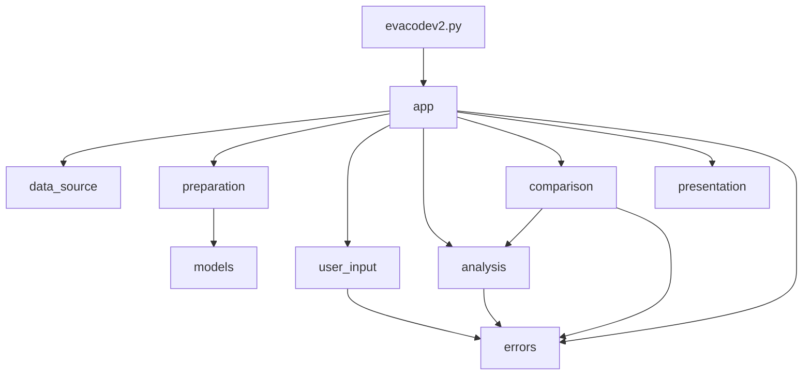

# Architecture

The original script is now a small package, `eva/`. `evacodev2.py` is only an entry point, so `python evacodev2.py` works as before. 
The reasoning is in [ADR-001](adr/ADR-001-split-by-responsibility.md).

## Modules

Each module has one job and changes for one reason.

| Module | Job |
| --- | --- |
| `evacodev2.py` | Entry point only (the original file, reduced to calling `eva.app.main`) |
| `app.py` | Coordinates a run: loads data, picks the mode, calls the others in order. No logic of its own |
| `data_source.py` | Reads the JSON file. Knows the file format and nothing else |
| `preparation.py` | Drops incomplete entries, converts dates and durations, sorts |
| `models.py` | `EvaRecord` (date, duration in hours, country), shared by preparation and analysis |
| `analysis.py` | Pure calculations and rules: filtering, running totals, duration categories, percentages, which country a typed name selects, whether a year range is valid |
| `comparison.py` | Compares two countries. Reuses `analysis` |
| `presentation.py` | The plot and all text output |
| `user_input.py` | Prompts, the `--compare` flag, parsing what the user types |
| `errors.py` | `InvalidQueryError` for requests that can't be answered |

`comparison.py` and `errors.py` came with the country-comparison feature. 
The original modules (`data_source`, `preparation`, `models`, `analysis`) were not touched for it.

## Dependencies



The rules that keep this simple:

- Only `app` knows about every module.
- `analysis` and `comparison` never read files, prompt, or draw anything.
- Nothing is read from global variables. 
Data is passed as arguments, and nothing runs when a module is imported.

## Interfaces

The functions other modules are meant to call:

```text
data_source.load_raw_records(path) -> list[dict]
preparation.prepare_records(raw) -> list[EvaRecord]        # sorted by date

analysis.filter_records(records, country=None, start_year=None, end_year=None)
analysis.cumulative_duration(records) -> (dates, cumulative_hours)
analysis.categorise_duration(hours) -> "short" | "standard" | "long"
analysis.count_duration_categories(records) -> dict[str, int]
analysis.category_percentages(counts) -> dict[str, float]
analysis.known_countries(records) -> set[str]
analysis.resolve_country(typed, known) -> country | None   # None = all countries
analysis.check_year_range(start, end)                      # raises InvalidQueryError

comparison.compare_countries(records, a, b, start_year, end_year) -> ComparisonResult

presentation.plot_cumulative_duration(country, dates, hours)
presentation.format_category_summary(counts, percentages) -> str
presentation.format_comparison(result) -> str

user_input.prompt_query() -> (typed_country, start | None, end | None)
user_input.prompt_comparison_query() -> (country_a, country_b, start, end)
user_input.parse_arguments(argv) -> Namespace
```

"All countries" is `None` rather than a magic string, and percentages stay numbers until `presentation` formats them.

## Why the boundaries are here

They follow what can change independently:

- New file format or location: only `data_source`.
- New cleaning rule: only `preparation`.
- New statistic or threshold: only `analysis`.
- New output (a table, a web page): only `presentation`.
- Different prompts: only `user_input`.

Inside each module, every function serves that one job. `preparation` answers "is this entry usable, and what is its typed form?". 
`analysis` turns records into numbers. 
`presentation` turns results into something a person sees.
`EvaRecord` has its own module so that `preparation` (which creates records) and `analysis` (which uses them) don't depend on each other.

## Coupling, before and after

`aggregate_data` used to read a global `records` list, index it by position, and expect year strings straight from `input()`. 
Analysis was tied to both the loader and the prompt. 
Now `filter_records` takes a list of `EvaRecord` and integer years, so the loader, the prompt and the analysis can each change on their own, and tests can call the analysis with handwritten records.

## How the comparison feature was added

| Module | Change |
| --- | --- |
| `comparison.py` (new) | Per-country count, total and average, plus the leader or a tie. Totals come from `analysis.filter_records` and `analysis.cumulative_duration`, so nothing is calculated twice |
| `errors.py` (new) | Lets `comparison` and `user_input` report bad requests without depending on each other (see [ADR-002](adr/ADR-002-invalid-query-error.md)) |
| `presentation.py` | Added `format_comparison` |
| `user_input.py` | Added `--compare` and `prompt_comparison_query` |
| `app.py` | `main` now picks `run_cumulative_analysis` (the old flow) or `run_country_comparison` |

Choices worth knowing:

- Comparison is a `--compare` flag, not a menu, so the original prompts and output stay exactly the same.
- Ties use `math.isclose`, because `0.1 + 0.2 != 0.3` in floating point.
- Rules live in `analysis` and `comparison` (years in order, countries exist).
Parsing typed text lives in `user_input`. 
Both raise `InvalidQueryError`, and `app` reports it.

## A later fix

After the feature was in, I checked the code against the brief and found two
things, fixed in a separate commit:

- The brief says the *application* must cope with invalid year ranges, but the original mode still crashed on reversed years, non-numeric years and empty results. 
It now prints a message and stops, using the same checks as the comparison.
- The assessment flagged `get_clean_inputs` for quietly turning an unknown country into "all countries", but the refactor had kept that rule inside `user_input`. 
It now lives in `analysis.resolve_country`, and `user_input` only returns what was typed.
